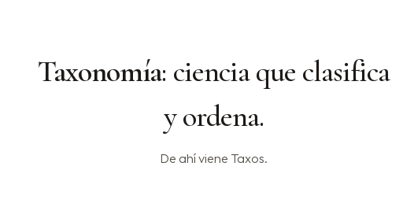
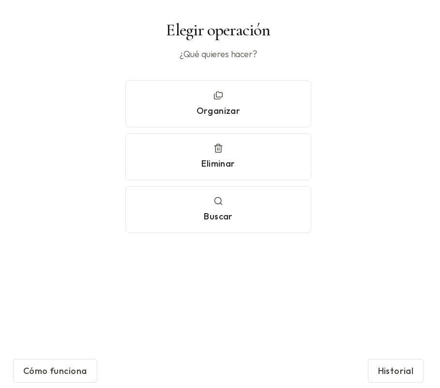
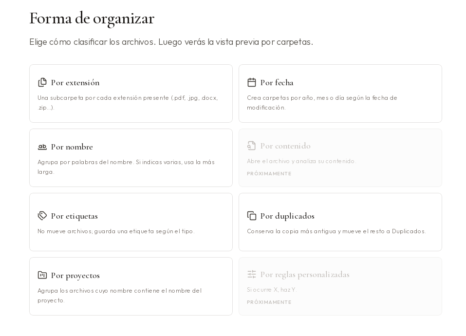
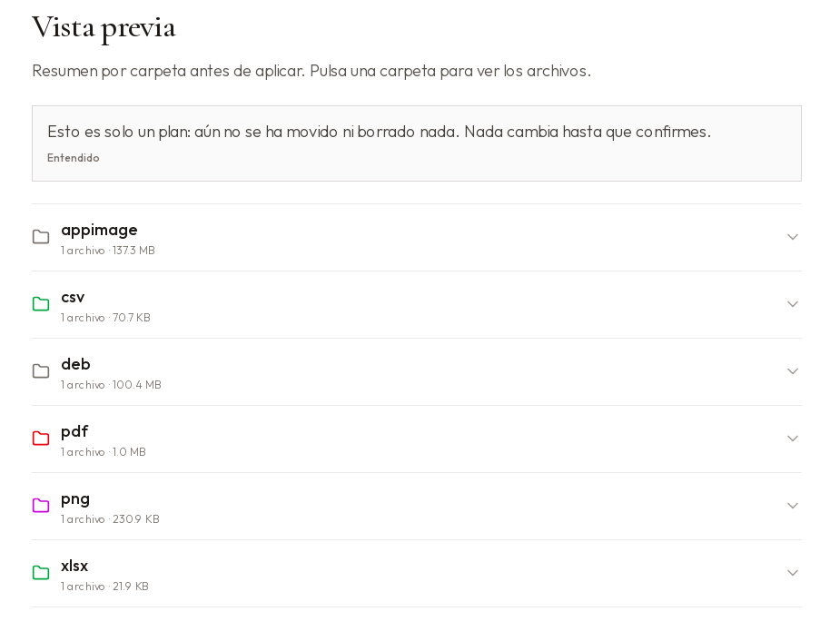

# Taxos

  

**Ordena tu carpeta Descargas** sin complicaciones.

Taxos te muestra qué va a hacer **antes** de mover o borrar nada.  
Si te arrepientes, puedes deshacer. Lo eliminado va a la **papelera**.

---

## Cómo empezar (Windows)

No necesitas instalar nada más.

1. Entra en **Releases** de este proyecto.
2. Descarga **Taxos-win64.zip**.
3. Descomprime la carpeta.
4. Abre **Taxos.exe**.

Si Windows avisa: *Más información* → *Ejecutar de todas formas*.

---

## Qué puedes hacer

- **Organizar** — separa archivos por tipo, fecha, nombre u otros modos.
- **Eliminar** — propone basura segura (temps, caché…) y tú eliges qué va a la papelera.
- **Buscar** — encuentra archivos sin revolver toda la carpeta.

---

## Un vistazo

  

<em>Al abrir Taxos</em>

  

<em>Elige qué quieres hacer</em>

  

<em>Elige cómo agrupar tus archivos</em>

  

<em>Siempre ves el plan antes de confirmar</em>

---

## Tranquilidad

- Nada se aplica sin tu confirmación.
- Lo borrado va a la papelera, no desaparece del todo.
- La IA es opcional y solo mira **nombres** de archivo, nunca el contenido.

---

¿Programas o usas Linux? → [docs/DESARROLLO.md](docs/DESARROLLO.md)

Licencia [MIT](LICENSE) · [Créditos de ilustraciones](docs/CREDITOS.md)
